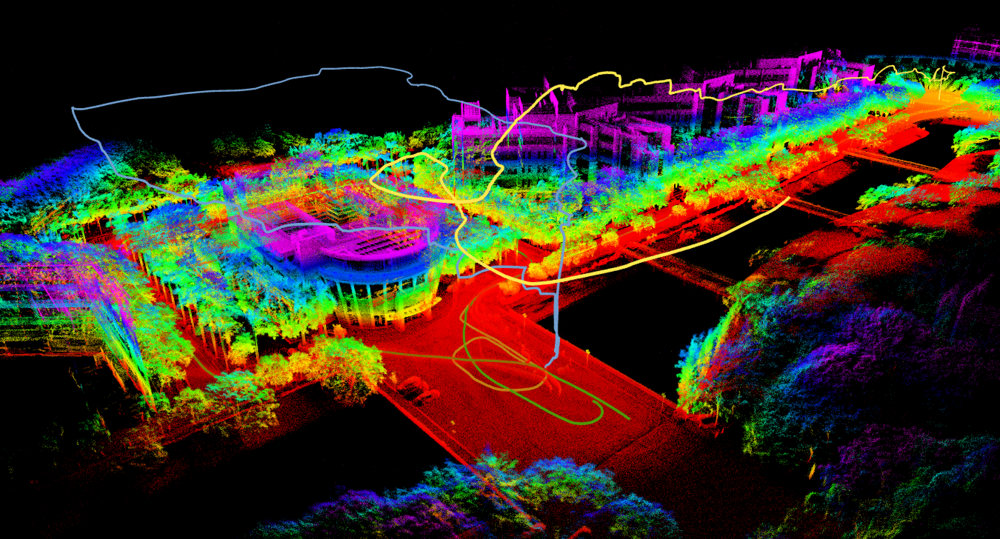

## <div align = "center">Effective Heterogeneous Point Cloud-Based Place Recognition and Relative Localization for Ground and Aerial Vehicles</div>

<div align="center">
<a href="https://ieeexplore.ieee.org/abstract/document/11128163">
</a>
<a href="https://www.bilibili.com/video/BV1vnQ6YGEfh/">
</a>
<a href="https://github.com/SYSU-RoboticsLab/EHPR">
</a>

</div>

> Rui Mao and Hui Cheng
>
> 2025 IEEE International Conference on Robotics and Automation
## Introduction
**EHPR** is a 3D LiDAR place recognition method tailored for the **heterogeneous robots scenario**. In this work, we propose a pipeline based on BEV density images, combined with an
**enhanced data structure**. An efficient **height alignment algorithm** is proposed for relative localization. We also show
that our method is capable to detect inter- and intra-robot loop
closures in a ground and aerial **multi-session SLAM system**.

If you find this work useful, please consider citing our paper:
<details>

```
@INPROCEEDINGS{11128163,
  author={Mao, Rui and Cheng, Hui},
  booktitle={2025 IEEE International Conference on Robotics and Automation (ICRA)}, 
  title={Effective Heterogeneous Point Cloud-Based Place Recognition and Relative Localization for Ground and Aerial Vehicles}, 
  year={2025},
  volume={},
  number={},
  pages={15828-15834},
  doi={10.1109/ICRA55743.2025.11128163}}
```
</details>

## Installation 
**a. Ubuntu and [ROS](https://www.ros.org/)**

We tested our code on Ubuntu 20.04 with noetic.

**b. Packages from ubuntu source**

```shell
sudo apt install libboost-dev libtbb-dev libgoogle-glog-dev
```
**c. [GTSAM](https://github.com/borglab/gtsam) for demo**

Following the official [GTSAM installation](https://gtsam.org/get_started/). We tested our code with GTSAM 4.2.

**d. Build and compile**
```
mkdir -p catkin_ws/src
cd catkin_ws/src
git clone https://github.com/SYSU-RoboticsLab/EHPR.git
cd ../..
catkin_make
```
## Example
This repository provides an implementation of **EHPR**, along with a simple demo of a **ground–aerial multi-session SLAM system**.

<div align="center">
    <div align="center">
        
    </div>

</div>

### Demo Data

To run the demo, download the LiDAR data collected by our UAV and UGV:

> [heterogeneous data](https://drive.google.com/file/d/1fmARuPct1b6kG6XbOgTzfr4SnpcVwXpY/view?usp=drive_link)

We use a front-end odometry method (e.g., [FAST-LIO2](https://github.com/hku-mars/FAST_LIO)) to estimate poses, then save each sequence in the following format:

```text
<sequence_name>/
├── pcd/
│   ├── 0.pcd                 # one scan per file
│   ├── 1.pcd
│   └── ...
├── raw_imu_data.txt          # timestamp + IMU measurements (e.g., ts qx qy qz qw ...)
├── register_lidar.txt        # timestamp + index + pointcloud filename (e.g., ts 0 0.pcd)
└── register_pose.txt         # timestamp + 3x4 pose matrix [R|t] (e.g., ts r11 r12 r13 tx r21 r22 r23 ty r31 r32 r33 tz)
```
> Note: If you use your own dataset, you can either follow the same file organization above or modify the input parser in the code to match your data format.

### Run the Demo
Edit the paths `ground_root` and `air_root` in `config/multisession_video.yaml` and launch the demo:
```
source deve/setup.bash
roslaunch ehpr multi_video.launch
```

## Acknowledgments
In the development of **EHPR**, we stand on the shoulders of the following repositories:

- [Contour Context](https://github.com/lewisjiang/contour-context): Abstract Structural Distribution for 3D LiDAR Loop Detection and Metric Pose Estimation
- [MapClosures](https://github.com/PRBonn/MapClosures): Effectively Detecting Loop Closures using Point Cloud Density Maps
- [STD](https://github.com/hku-mars/STD): A Stable Triangle Descriptor for 3D place recognition
- [HBST](https://gitlab.com/srrg-software/srrg_hbst/-/wikis/home): Hamming Binary Search Tree
## Contact Us
For any technical issues, please contact us via email Rui Mao(<maor8@mail2.sysu.edu.cn>).
